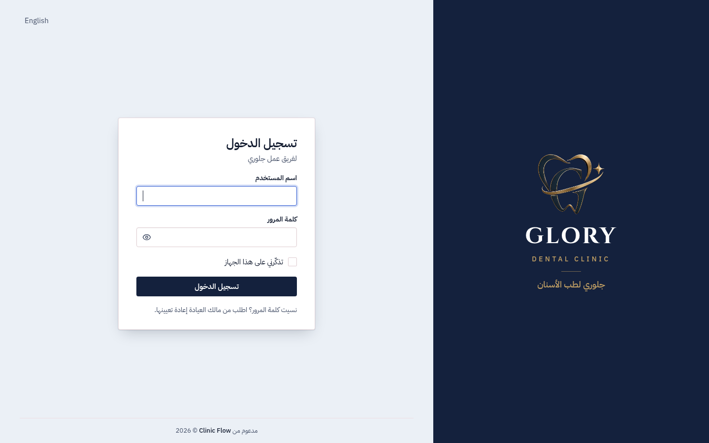

# Clinic Flow: Multi-tenant Clinic Management Platform

A white-label clinic management platform: one deployment serves many clinics, and each clinic's data is fully isolated. It is Arabic-first (right-to-left), with English as a second language.

**In production:** Glory Dental Clinic runs on Clinic Flow today.

**Fully customizable per clinic:** every clinic gets its own logo, colors, theme and name. The screenshot below shows Glory's branding.

## Features
- **Multi-tenant & white-label:** clinics, branches and operatories, each clinic's data isolated, with its own logo, theme and name
- **Patients and charts:** dental chart, treatment plans, patient notes and file numbers
- **Scheduling:** calendar with drag-to-reschedule, shifting a whole day's appointments, follow-up calls
- **Lab cases:** notifications when a lab case is back and ready to book the fitting
- **Finance:** partners, percentages and owner payouts
- **Reliability:** saves wait out a dropped connection, with an offline banner
- Arabic/English UI with full right-to-left support, Excel export, QR codes, iPhone HEIC photo upload

## My role: backend & security
- Built staff accounts, **sign-in lockouts**, **two-step sign-in (2FA)**, and a forced change of the starting password
- Built the admin console's sign-in, sessions and per-clinic permissions
- Designed the multi-tenant data model (clinic → branch → operatory)
- Built scheduling and follow-up logic on PostgreSQL
- Set up testing (Vitest, end-to-end and scenario tests before deploys, which caught real bugs)

## Tech stack
Next.js · React · TypeScript · PostgreSQL · Drizzle ORM · next-intl · Tailwind CSS · Radix UI · Zod · Vitest · Docker

> **Source code is private** (client/team project). This page shows what was built and the result. Happy to walk through the code and architecture in an interview.
